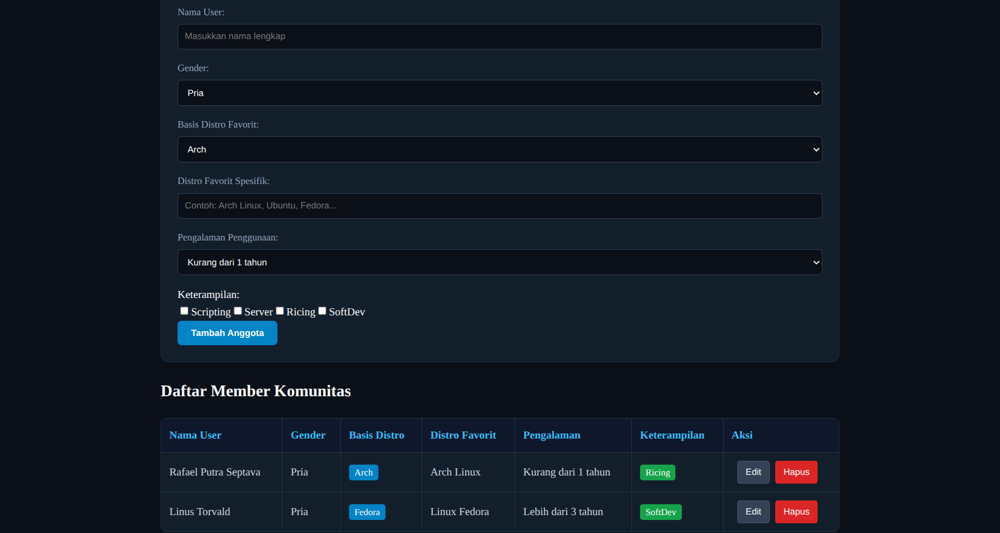
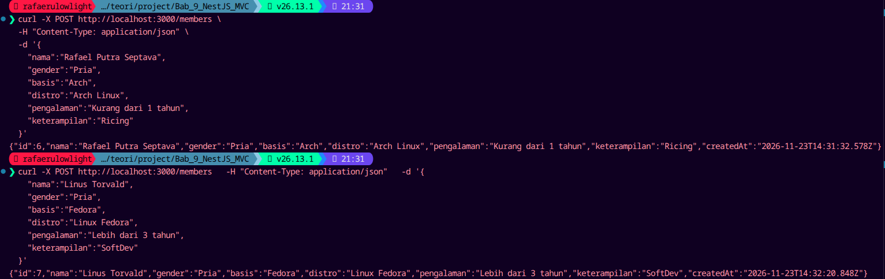
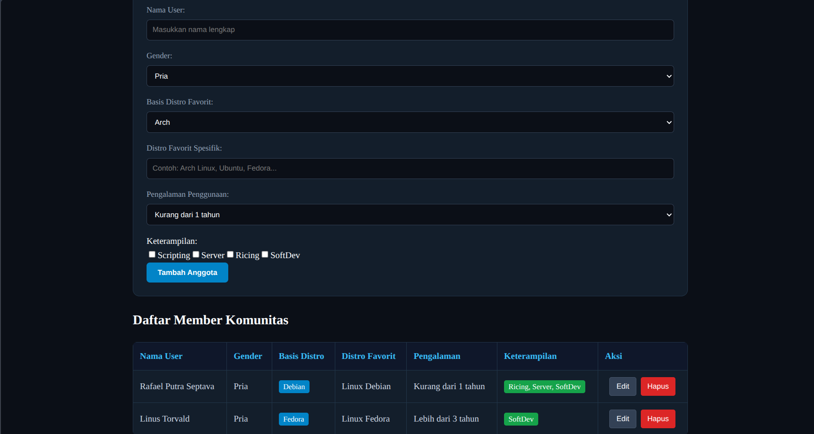
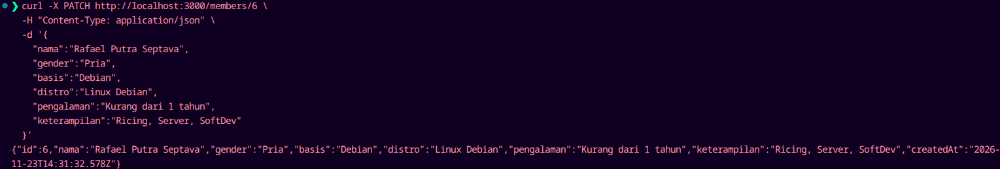
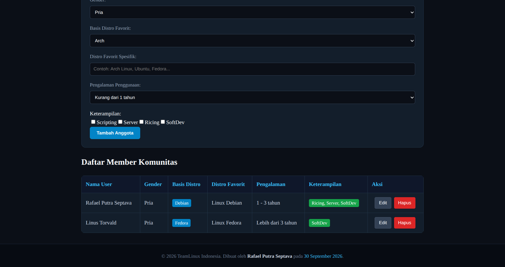
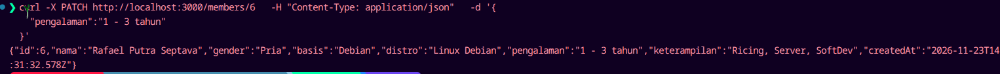
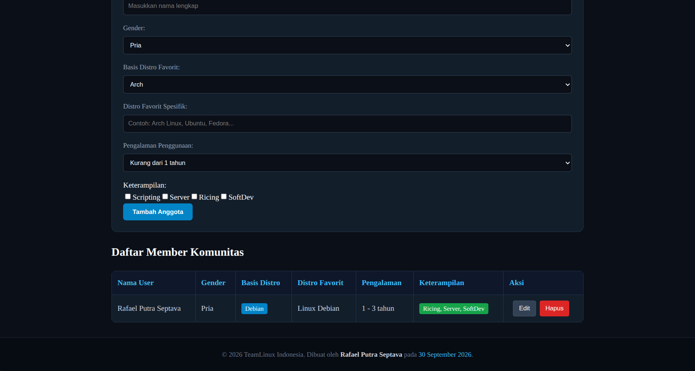
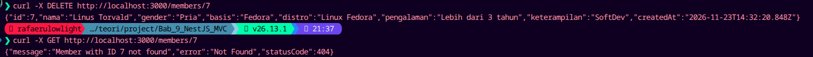
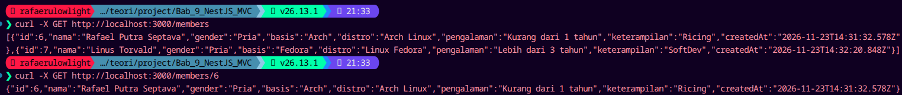

# TeamLinux Indonesia — NestJS MVC dengan React

Aplikasi full-stack CRUD anggota komunitas Linux dengan frontend React, TypeScript, dan Vite serta backend NestJS. Data member saat ini disimpan sementara di array dalam memori.

## Tujuh Langkah Implementasi

1. **Membuat resource:** Perintah Nest CLI `nest g resource members` menghasilkan kerangka REST API untuk fitur anggota, termasuk module, controller, service, DTO, dan entity. Kerangka ini menjadi dasar pengembangan fitur CRUD member.
2. **Menyesuaikan Entity:** Model member disesuaikan dengan kebutuhan formulir, seperti nama, gender, basis distro, distro favorit, pengalaman, keterampilan, ID, dan waktu pendaftaran. Field menggunakan tipe data yang sesuai agar bentuk data konsisten di backend.
3. **Membuat Service CRUD:** Service mengimplementasikan operasi create, findAll, findOne, update, dan remove pada array in-memory. Dengan demikian, data dapat dikelola tanpa database selama aplikasi berjalan, tetapi akan terhapus ketika backend dimulai ulang.
4. **Membuat Controller:** Controller menyediakan endpoint GET, POST, PATCH, dan DELETE untuk setiap operasi member. Semua handler memperoleh dan memanggil service melalui dependency injection NestJS.
5. **Menambahkan validasi dan error:** DTO memakai `class-validator` untuk memeriksa tipe, panjang, serta pilihan nilai input, dan `ValidationPipe` diterapkan secara global. Backend juga mengembalikan exception yang sesuai ketika member tidak ditemukan atau update dikirim tanpa field.
6. **Menguji REST API:** File `backend/members.http` berisi request untuk membuat, membaca, mengubah, dan menghapus member, termasuk contoh respons error. Endpoint telah diuji untuk memastikan status HTTP dan perubahan datanya sesuai harapan.
7. **Menghubungkan frontend:** Client API di frontend berkomunikasi dengan NestJS melalui proxy Vite `/api`. Pengguna dapat memuat daftar member serta menjalankan alur tambah, edit, dan hapus langsung dari antarmuka.

## Endpoint REST API

Backend menyediakan endpoint berikut:

| Method   | Endpoint       | Fungsi                             |
| -------- | -------------- | ---------------------------------- |
| `POST`   | `/members`     | Menambah anggota                   |
| `GET`    | `/members`     | Menampilkan semua anggota          |
| `GET`    | `/members/:id` | Menampilkan anggota berdasarkan ID |
| `PATCH`  | `/members/:id` | Mengubah data anggota              |
| `DELETE` | `/members/:id` | Menghapus anggota                  |

Contoh menambah anggota:

```bash
curl -X POST http://localhost:3000/members \
  -H "Content-Type: application/json" \
  -d '{
    "nama":"Rafael Putra Septava",
    "gender":"Pria",
    "basis":"Arch",
    "distro":"Arch Linux",
    "pengalaman":"Kurang dari 1 tahun",
    "keterampilan":"Ricing"
  }'
```

Contoh melihat semua anggota:

```bash
curl -X GET http://localhost:3000/members
```

Contoh melihat anggota berdasarkan ID. Ganti `1` dengan ID anggota yang tersedia:

```bash
curl -X GET http://localhost:3000/members/1
```

Contoh mengubah seluruh atau sebagian data anggota menggunakan metode `PATCH`:

```bash
curl -X PATCH http://localhost:3000/members/1 \
  -H "Content-Type: application/json" \
  -d '{
    "nama":"Rafael Putra Septava",
    "gender":"Pria",
    "basis":"Debian",
    "distro":"Linux Debian",
    "pengalaman":"Kurang dari 1 tahun",
    "keterampilan":"Ricing, Server"
  }'
```

Contoh mengubah hanya satu data anggota:

```bash
curl -X PATCH http://localhost:3000/members/1 \
  -H "Content-Type: application/json" \
  -d '{
    "distro":"Debian 13"
  }'
```

Contoh menghapus anggota berdasarkan ID:

```bash
curl -X DELETE http://localhost:3000/members/1
```

Contoh mengecek data yang sudah dihapus:

```bash
curl -X GET http://localhost:3000/members/1
```

Jika ID tidak ditemukan, backend akan mengembalikan status `404 Not Found`.

## Cara Menjalankan dengan Ringkas

Jalankan backend di terminal pertama dari root proyek:

```bash
cd backend
bun install
bun run start:dev
```

Jalankan frontend di terminal kedua, juga dari root proyek:

```bash
bun run dev
```


## Dokumenasi Gambar

### Post



### Patch



### Patch with ID



### Delete



### Get


